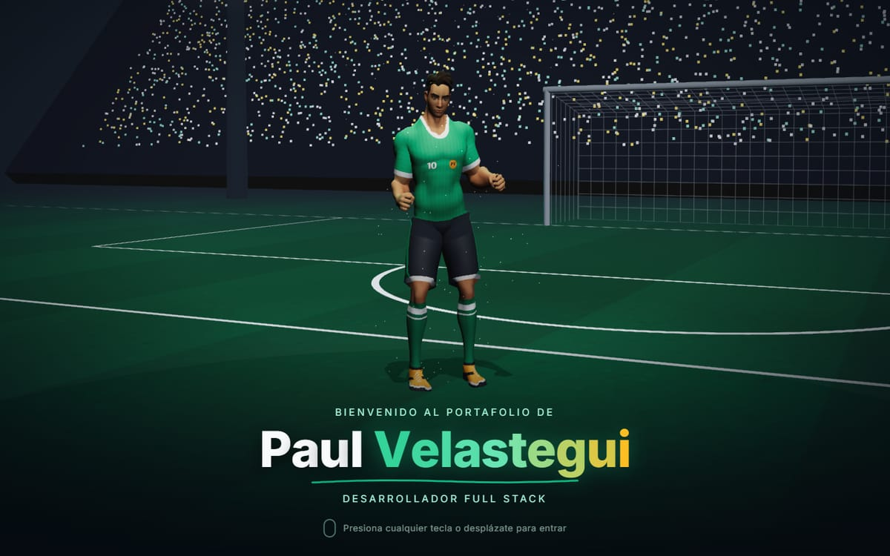

<!-- Encabezado: estadio de noche -->

  

  

  
  
  
  

<!-- Vista del portafolio -->

  
   
  ⚽ Mi portafolio: un estadio 3D con intro estilo videojuego · <a href="https://paul-23ve.github.io">entra a la cancha</a>

---

## 🧑‍💻 Sobre mí · *el jugador*

Soy **Paul Velastegui**, desarrollador full stack de **Ambato, Ecuador**, y estudiante de **Ingeniería de Software** en la **Universidad Técnica de Ambato**. Construyo sistemas completos: interfaces cuidadas, APIs REST que las sostienen y bases de datos bien diseñadas.

> 🎯 **Objetivo profesional:** crecer como desarrollador full stack aportando a equipos que construyen productos web reales: interfaces cuidadas con React y APIs sólidas con Node.js y NestJS, con código limpio, buenas prácticas y entregas que generen valor para el negocio.

- 💼 Hoy juego como **desarrollador front-end y back-end en Euroman Ecuador**.
- 🌱 Hice mis **prácticas preprofesionales en la Cooperativa Mushuc Runa Ltda.**: un sistema de gestión ganadera completo.
- 🤝 Me gusta el juego en equipo: ramas, revisiones de código y entregas por partes que se integran sin sorpresas.
- ⚽ Fuera del código juego fútbol, y me llevo lo mismo a cada proyecto: constancia y ganas de mejorar en cada partido.

## 🏟️ Trayectoria · *los clubes*

| Posición | Club | Temporada |
| :-- | :-- | :-- |
| **Desarrollador Front-end y Back-end** | Euroman Ecuador | Enero 2026 – actualidad |
| **Prácticas preprofesionales · Full Stack** | Cooperativa Mushuc Runa Ltda. | 2026 |

**Euroman Ecuador:** sistema de proformas con React y Node.js (frontend y backend), APIs REST para clientes y productos, y optimización de consultas en bases de datos relacionales. 
**Mushuc Runa:** sistema de gestión ganadera con Angular, Node.js, Express, Prisma y PostgreSQL, con notificaciones en tiempo real y reportes en PDF y Excel.

## ⚽ Proyectos destacados · *los goles*

<table>
  <tr>
    <td width="50%" valign="top">
      
      <h3>🐄 Mushuc Granja</h3>
      
Sistema de gestión ganadera para el Complejo Mushuc Runa: fichas de animales con árbol genealógico, inventario, equipos, contabilidad y reportes.

      

        
        
        
        
        
      

      Prácticas preprofesionales · Cooperativa Mushuc Runa Ltda. · 🔒 repositorio privado
    </td>
    <td width="50%" valign="top">
      
      <h3>⛽ FuelWise</h3>
      
Registro y análisis del consumo de combustible de una flota: panel de indicadores, vehículos, mantenimiento y reportes.

      

        
        
        
        
      

      Equipo: <a href="https://github.com/GrupoDistribuidas">Grupo Distribuidas</a> · <a href="https://github.com/GrupoDistribuidas/Frontend_ControlCombustible">Frontend</a> · <a href="https://github.com/GrupoDistribuidas/Backend_ControlCombustible">Backend</a>
    </td>
  </tr>
  <tr>
    <td width="50%" valign="top">
      
      <h3>💊 Farma Ya</h3>
      
Plataforma para farmacias con panel administrativo, tienda en línea y app móvil conectadas a una sola API REST.

      

        
        
        
        
      

      Equipo: con <a href="https://github.com/HamiltonStJJ">HamiltonStJJ</a> · Web + móvil · 🔒 repositorio privado
    </td>
    <td width="50%" valign="top">
      
      <h3>🛒 Marketplace Multiempresa</h3>
      
Varios negocios publican productos, gestionan su inventario y reciben pedidos en una sola plataforma.

      

        
        
        
        
      

      Equipo: con <a href="https://github.com/DavidGR21">DavidGR21</a> y <a href="https://github.com/xxxMichael">xxxMichael</a> · <a href="https://github.com/DavidGR21/MULTI-COMPANY_SALES_SYSTEM_FRONTEND">Frontend</a> · <a href="https://github.com/xxxMichael/MULTI-COMPANY_SALES_SYSTEM">Backend</a>
    </td>
  </tr>
</table>

  🎮 También desarrollé <a href="https://github.com/DavidGR21/Pixel-Odyssey"><b>Pixel Odyssey</b></a>, un RPG pixel art en Unity y C# (con <a href="https://github.com/DavidGR21">DavidGR21</a>). 
  <a href="https://paul-23ve.github.io/#projects"><b>→ Ver todos los proyectos con capturas en mi portafolio</b></a>

## 🛠️ Tecnologías · *la táctica*

<table>
  <tr>
    <td align="right"><b>Frontend</b></td>
    <td></td>
  </tr>
  <tr>
    <td align="right"><b>Backend</b></td>
    <td></td>
  </tr>
  <tr>
    <td align="right"><b>Datos</b></td>
    <td></td>
  </tr>
  <tr>
    <td align="right"><b>Herramientas</b></td>
    <td></td>
  </tr>
</table>

## 🏆 Certificaciones · *los trofeos*

| Certificado | Emisor | Fecha |
| :-- | :-- | :-- |
| JavaScript Essentials 1 | Cisco Networking Academy · JS Institute | Nov 2026 |
| Data Science Essentials with Python | Cisco Networking Academy | Sep 2026 |
| Soporte y Seguridad de Red | Universidad Técnica de Ambato · Cisco | Dic 2024 |
| Introduction to Cybersecurity | Cisco Networking Academy | Jun 2024 |
| Introduction to Packet Tracer | Cisco Networking Academy | Abr 2023 |

Puedes ver cada certificado en <a href="https://paul-23ve.github.io/#certificates">mi portafolio</a>.

## 🎽 Fuera de la cancha · *hobbies*

⚽ Fútbol &nbsp;·&nbsp; 🎮 Videojuegos y su desarrollo &nbsp;·&nbsp; 🚀 Aprender tecnologías nuevas &nbsp;·&nbsp; 🤝 Trabajo en equipo

## 📊 Estadísticas · *el marcador*

  
  

  

## 📫 Hablemos · *convocatoria abierta*

¿Tienes un proyecto, una vacante o una idea? Escríbeme desde el **[formulario de contacto de mi portafolio](https://paul-23ve.github.io/#contact)** o a **[paulvelastegui2016@gmail.com](mailto:paulvelastegui2016@gmail.com)**. Respondo lo antes posible.

  

